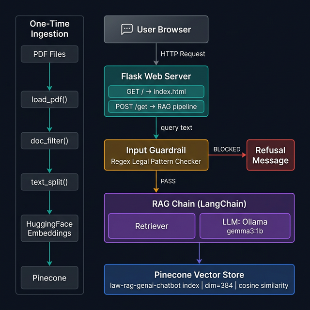
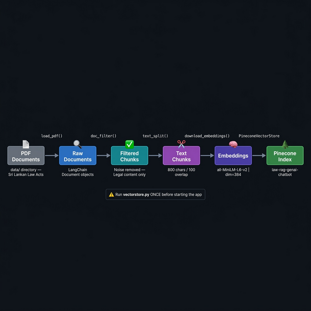

# ⚖️ Sri Lankan Law AI Assistant

> A **Retrieval-Augmented Generation (RAG)** chatbot built with **LangChain · Pinecone · Ollama · Flask** — answers legal questions strictly grounded in Sri Lankan statutory documents.

<p align="center">
  
  
  
  
  
</p>

---

## 📌 Table of Contents

- [Overview](#-overview)
- [System Architecture](#-system-architecture)
- [Data Ingestion Pipeline](#-data-ingestion-pipeline)
- [Project Structure](#-project-structure)
- [Tech Stack](#-tech-stack)
- [Prerequisites](#-prerequisites)
- [Installation](#-installation)
- [Configuration](#-configuration)
- [How Each Module Works](#-how-each-module-works)
- [Data Ingestion — One-Time Setup](#-data-ingestion--one-time-setup)
- [Running the Application](#-running-the-application)
- [Switching LLM Backends](#-switching-llm-backends)
- [LangSmith Observability](#-langsmith-observability)
- [Troubleshooting](#-troubleshooting)

---

## 🧠 Overview

The **Sri Lankan Law AI Assistant** is a domain-specific legal chatbot that answers questions **exclusively** from the content of Sri Lankan legal PDF documents. It will never hallucinate or use general world knowledge — it either finds the answer in the indexed statutes or says it cannot.

### How it works at a high level

| Step | What happens |
|------|-------------|
| **Ingest** | PDFs are loaded, noise-filtered, chunked, and embedded into Pinecone (run once) |
| **Guard** | Every incoming query passes a regex-based legal topic filter |
| **Retrieve** | The top 5 most semantically similar document chunks are fetched from Pinecone |
| **Generate** | A local LLM (Ollama `gemma3:1b`) is prompted with the chunks as context |
| **Respond** | A cited, formal legal answer is returned to the user's browser |

---

## 🏗️ System Architecture



The diagram above shows the complete request/response lifecycle:

1. The **User Browser** sends a message via the chat UI
2. **Flask** routes it to the `/get` endpoint
3. The **Input Guardrail** checks if the query contains legal keywords — blocked queries return a refusal message immediately, without touching the LLM
4. The **RAG Chain** (LangChain) retrieves context from **Pinecone** and passes it along with the query to the **LLM**
5. The formatted answer returns up through the chain to the browser

---

## 🔄 Data Ingestion Pipeline



The ingestion pipeline (`vectorstore.py`) processes raw PDF files into searchable vector embeddings stored in Pinecone. This runs **only once** (or any time you add new documents).

---

## 📁 Project Structure

```
Law RAG Chatbot/
│
├── app.py                  # 🚀 Flask server — main entry point
├── vectorstore.py          # 📦 One-time ingestion: PDFs → Pinecone
├── requirements.txt        # 📋 Python dependencies
├── setup.py                # ⚙️  Package metadata (editable install)
├── .env                    # 🔑 API keys and environment variables
├── .gitignore
│
├── data/                   # 📄 Place Sri Lankan law PDF files here
│   └── *.pdf
│
├── src/                    # 🧩 Core application modules
│   ├── __init__.py
│   ├── helper.py           # PDF loading, filtering, chunking, embeddings
│   ├── prompt.py           # LLM system prompt template
│   ├── retriever.py        # Pinecone retriever factory
│   └── Guardrails.py       # Input-level topic safety filter
│
├── templates/
│   └── index.html          # 💬 Chat web UI (Jinja2 template)
│
├── static/                 # 🎨 CSS / JS / image assets
│
└── research/               # 🔬 Jupyter notebooks (optional experiments)
```

---

## 🛠️ Tech Stack

| Layer | Technology | Role |
|-------|-----------|------|
| **Web Server** | Flask 3.1.1 | Serves UI and REST API |
| **LLM — Default** | Ollama `gemma3:1b` | Local, free, private inference |
| **LLM — Alternatives** | OpenRouter / Google Gemini | Cloud-based inference options |
| **Orchestration** | LangChain 0.3.26 | Chains, retrievers, prompts |
| **Embeddings** | `all-MiniLM-L6-v2` (HuggingFace) | 384-dim semantic text vectors |
| **Vector Store** | Pinecone Serverless (AWS us-east-1) | Similarity search over legal chunks |
| **Observability** | LangSmith | Chain tracing and debugging |
| **PDF Parser** | PyPDF + LangChain DirectoryLoader | Extracts text from statutes |
| **Environment** | python-dotenv | Secure key management |

---

## ✅ Prerequisites

Before installing, make sure you have the following:

| Requirement | Version | Notes |
|-------------|---------|-------|
| **Python** | 3.10 or 3.11 | [python.org](https://python.org) |
| **Ollama** | Latest | [ollama.com](https://ollama.com) — runs the LLM locally |
| **Pinecone Account** | Free tier | [pinecone.io](https://pinecone.io) |
| **LangSmith Account** | Free tier | [smith.langchain.com](https://smith.langchain.com) |
| **Git** | Any | For cloning the repo |

### Install and Configure Ollama

After installing Ollama, pull the model used by this project:

```bash
# Pull the default LLM
ollama pull gemma3:1b

# Verify it's available
ollama list
```

---

## 📦 Installation

### Step 1 — Clone the Repository

```bash
git clone https://github.com/PasinduGunathilake/Srilankan-LAW-Assistant-GenAI-RAG-Chatbot-Using-LangChain-Python-Pinecone-Streamlit-AWS.git
cd "Law RAG Chatbot"
```

### Step 2 — Create a Virtual Environment

```bash
# Windows
python -m venv lawvenv
lawvenv\Scripts\activate

# macOS / Linux
python -m venv lawvenv
source lawvenv/bin/activate
```

### Step 3 — Install All Dependencies

```bash
pip install -r requirements.txt
```

This installs the complete dependency set:

| Package | Version | Purpose |
|---------|---------|---------|
| `langchain` | 0.3.26 | Core RAG orchestration framework |
| `langchain-core` | 0.3.66 | Base abstractions (Runnables, Documents) |
| `langchain-community` | 0.3.26 | PDF loaders, HuggingFace embeddings |
| `langchain-ollama` | 0.2.1 | Ollama LLM integration |
| `langchain-openai` | 0.3.24 | OpenAI / OpenRouter integration |
| `langchain-pinecone` | 0.2.8 | Pinecone vector store integration |
| `flask` | 3.1.1 | Web server and REST API |
| `flask-cores` | — | CORS support for Flask |
| `sentence-transformers` | 4.1.0 | HuggingFace embedding model runner |
| `pypdf` | 5.6.1 | PDF page extraction |
| `python-dotenv` | 1.0.0 | Loads `.env` variables at runtime |
| `ipykernel` | 7.1.0 | Jupyter support (optional) |
| `-e .` | — | Editable install of this project via `setup.py` |

---

## 🔑 Configuration

### Step 4 — Set Up the `.env` File

Create or edit the `.env` file in the project root with your actual API keys:

```env
# ─── Pinecone (required) ────────────────────────────────
PINECONE_API_KEY="your-pinecone-api-key-here"

# ─── LangSmith Tracing (required) ───────────────────────
LANGCHAIN_API_KEY="your-langsmith-api-key-here"
LANGCHAIN_TRACING_V2="true"
LANGCHAIN_TRACING_PROJECT_NAME="law_rag_genai_assistant"

# ─── Cloud LLM Alternatives (optional) ──────────────────
# OPENROUTER_API_KEY="your-openrouter-key-here"
# GOOGLE_API_KEY="your-google-ai-key-here"
```

> **Where to get your keys:**
> - 🔑 **Pinecone** → [app.pinecone.io](https://app.pinecone.io) → API Keys
> - 🔑 **LangSmith** → [smith.langchain.com](https://smith.langchain.com) → Settings → API Keys

> ⚠️ **Never commit your `.env` file to Git.** It is already in `.gitignore`.

---

## 🧩 How Each Module Works

### `src/helper.py` — Data Pipeline Utilities

The backbone of the ingestion pipeline. Provides four functions:

```
load_pdf() → doc_filter() → text_split() → download_embeddings()
```

| Function | What it does |
|----------|-------------|
| `load_pdf(path)` | Uses LangChain `DirectoryLoader` + `PyPDFLoader` to read all `*.pdf` files from the given directory into a list of `Document` objects |
| `doc_filter(docs)` | Removes noise pages — table of contents, gazette notices, price tags — using `NOISE_PATTERNS`. Keeps only pages matching `LEGAL_PATTERNS` (e.g., *"Act No."*, *"section 5"*) or at least 4 `WEAK_LEGAL_SIGNALS` (e.g., *"shall"*, *"court"*, *"minister"*) |
| `text_split(doc_list)` | Splits filtered documents into overlapping chunks using `RecursiveCharacterTextSplitter` — **800 character chunks** with **100 character overlap** — to preserve sentence context across boundaries |
| `download_embeddings()` | Loads `sentence-transformers/all-MiniLM-L6-v2` from HuggingFace — a fast, lightweight model that produces **384-dimensional** semantic vectors |

---

### `src/prompt.py` — System Prompt

Defines `system_prompt_text` — the strict instruction template that controls LLM behaviour:

```
You are a Legal Information Assistant for Sri Lankan law.

RULES:
1. Answer using ONLY the retrieved documents.
2. If not found, say: "The query cannot be answered as it is not supported..."
3. Cite sources: mention act name, section, or page number from the context.
4. Use formal legal language.
5. Do NOT use external knowledge.
Context: {context}
```

The `{context}` placeholder is filled at runtime with the retrieved document chunks.

---

### `src/Guardrails.py` — Input Safety Filter

A **rule-based guardrail** that runs before the RAG chain is invoked:

```
User Query → input_guardrail() → True / False
                                    │         │
                                  PASS      BLOCK
                                    │         │
                                 RAG chain  REFUSAL_MESSAGE
```

| Item | Detail |
|------|--------|
| `LEGAL_PATTERNS` | Regex list: `\blaw\b`, `\bcourt\b`, `\bpenalty\b`, `\bsection\s+\d+`, `\bconstitution\b`, etc. |
| `input_guardrail(query)` | Returns `True` if ≥ 1 pattern matches the lowercased query |
| `REFUSAL_MESSAGE` | Politely declines off-topic queries without ever calling the LLM |

This prevents prompt injection attempts and keeps the system focused on its domain.

---

### `src/retriever.py` — Pinecone Retriever Factory

Connects to the pre-populated Pinecone index and returns a LangChain-compatible retriever:

| Function | What it does |
|----------|-------------|
| `load_vectorstore_index()` | Opens the `law-rag-genai-chatbot` index using the same embedding model used during ingestion |
| `get_retriever(k=5)` | Returns a similarity-search retriever that fetches the **top 5** most semantically relevant chunks for a given query |

---

### `vectorstore.py` — One-Time Ingestion Script

Runs the complete ingestion pipeline and uploads to Pinecone:

```
Step 1: load_pdf("./data")          → raw Document list
Step 2: doc_filter(loaded_data)     → noise-removed Document list
Step 3: text_split(filtered_data)   → chunked Document list
Step 4: download_embeddings()       → HuggingFace embedding model
Step 5: Pinecone.create_index()     → creates index if not exists
        name="law-rag-genai-chatbot"
        dimension=384, metric="cosine"
        spec=ServerlessSpec(cloud="aws", region="us-east-1")
Step 6: PineconeVectorStore.from_documents() → uploads all chunks
```

---

### `app.py` — Flask Web Server (Main Entry Point)

Wires every component into a running web application:

```
Startup:
  load_dotenv() → check API keys → get_retriever() → init ChatOllama LLM
  → build ChatPromptTemplate → build QnA_chain → build RAG_chain

Routes:
  GET  /      → render_template("index.html")
  POST /get   → read msg → input_guardrail() → RAG_chain.invoke() → return answer
```

| Setting | Value |
|---------|-------|
| Host | `0.0.0.0` (all interfaces) |
| Port | `8080` |
| LLM | `ChatOllama(model="gemma3:1b", temperature=0.1)` |
| Retriever | Top-5 cosine similarity from Pinecone |

---

## 📥 Data Ingestion — One-Time Setup

### Step 5 — Add Your Legal PDF Files

Place your Sri Lankan statutory PDF documents inside the `data/` directory:

```
data/
├── intellectual_property_act.pdf
├── penal_code.pdf
├── criminal_procedure_code.pdf
├── companies_act.pdf
└── ...
```

### Step 6 — Run the Ingestion Script

> ⚠️ **Run this only once** (or when adding new PDFs). It will create and populate the Pinecone index. May take several minutes for large document sets.

```bash
python vectorstore.py
```

Expected console output:

```
Filtering 1240 documents...
kept 874/1240 (70.5%)
```

Once complete, your `law-rag-genai-chatbot` index in Pinecone is ready.

---

## 🚀 Running the Application

### Step 7 — Start Ollama (background service)

```bash
ollama serve
```

Keep this terminal open. Ollama must be running before starting Flask.

### Step 8 — Start the Flask Server

```bash
python app.py
```

Output:

```
 * Running on http://0.0.0.0:8080
 * Debug mode: on
```

### Step 9 — Open the Chat Interface

Navigate to **[http://localhost:8080](http://localhost:8080)** in your browser.

**Try these example queries:**

```
What are the punishments for intellectual property offences under Sri Lankan law?
Explain section 15 of the Penal Code.
What powers does the court have under the Criminal Procedure Code?
What constitutes an offence under the Companies Act?
```

---

## 🔀 Switching LLM Backends

The default is Ollama (local, free). Two cloud alternatives are already prepared in `app.py` as comments — just uncomment and configure:

### Option A — OpenRouter (Free Cloud Tier)

```python
from langchain_openai import ChatOpenAI

LLM = ChatOpenAI(
    model="google/gemini-2.5-flash:free",
    openai_api_key=os.getenv("OPENROUTER_API_KEY"),
    openai_api_base="https://openrouter.ai/api/v1",
    temperature=0.1
)
```

Add to `.env`: `OPENROUTER_API_KEY="your-key"`

### Option B — Google Gemini (Cloud)

```python
from langchain_google_genai import ChatGoogleGenerativeAI

LLM = ChatGoogleGenerativeAI(
    model="gemini-2.5-flash",
    google_api_key=os.getenv("GOOGLE_API_KEY"),
    temperature=0.1,
    max_retries=2
)
```

Add to `.env`: `GOOGLE_API_KEY="your-key"`

Install the extra package:
```bash
pip install langchain-google-genai
```

| | Ollama | OpenRouter | Google Gemini |
|-|--------|-----------|--------------|
| **Cost** | Free | Free tier | Pay-per-token |
| **Privacy** | ✅ Fully local | ❌ Cloud | ❌ Cloud |
| **Speed** | Depends on hardware | Fast | Fast |
| **Setup** | Requires local GPU/CPU | API key only | API key only |

---

## 📊 LangSmith Observability

Every chain invocation is traced to **LangSmith**, giving you full visibility into:
- Which document chunks were retrieved
- The exact prompt sent to the LLM
- LLM latency and token usage
- Any chain errors or retries

**Dashboard:** [smith.langchain.com](https://smith.langchain.com) → Project: `law_rag_genai_assistant`

> ⚠️ If `LANGCHAIN_API_KEY` is missing or `LANGCHAIN_TRACING_V2` ≠ `"true"`, the app will **refuse to start** with a `RuntimeError`.

---

## 🔧 Troubleshooting

| Problem | Likely Cause | Fix |
|---------|-------------|-----|
| `RuntimeError: LANGCHAIN_API_KEY NotFound!` | Key missing from `.env` | Add your LangSmith API key |
| `RuntimeError: PINECONE_API_KEY NotFound!` | Key missing from `.env` | Add your Pinecone API key |
| `ConnectionError` to Ollama | Ollama daemon not running | Run `ollama serve` in a terminal |
| `model not found` | Model not pulled | Run `ollama pull gemma3:1b` |
| Empty / irrelevant answers | Pinecone index not populated | Run `python vectorstore.py` first |
| Guardrail blocks a valid question | Query lacks legal keywords | Rephrase to include *law*, *court*, *act*, *section*, or *penalty* |
| Slow first response (~30s) | Embedding model downloading | `all-MiniLM-L6-v2` (~90 MB) downloads once; subsequent starts are fast |
| `ModuleNotFoundError: src` | Package not installed | Ensure you ran `pip install -r requirements.txt` (includes `-e .`) |

---

## 👤 Author

**Pasindu Gunathilake**
📧 pasindugunathilake144@gmail.com
🔗 [GitHub](https://github.com/PasinduGunathilake)

---

## 📜 License

This project is for educational and research purposes.
Legal documents used must be sourced from official Sri Lankan government publications.
